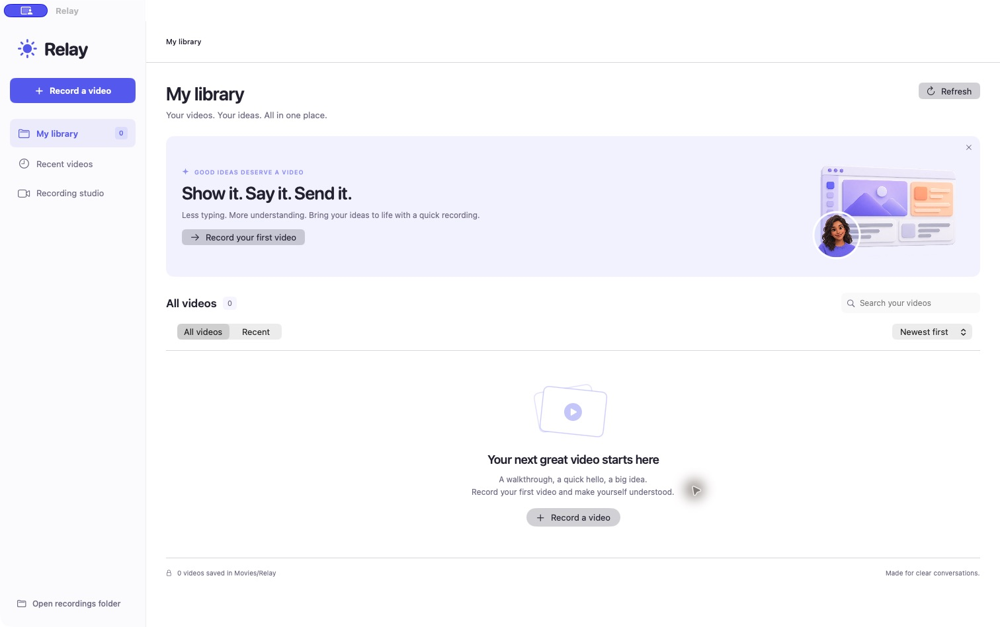
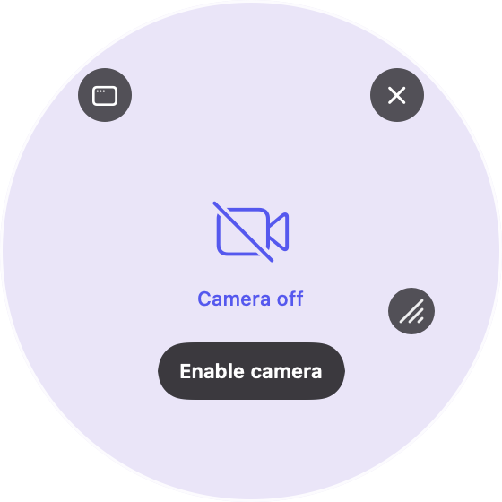

# Relay for macOS

Record your screen, camera, and voice with a native Mac app. Turn walkthroughs, quick updates, and big ideas into videos that stay on your Mac.

**[Download Relay 0.1.1 for Apple Silicon](https://github.com/othnielvtf/relay-macos/releases/tag/v0.1.1)** · macOS 15 or later

The release is a locally signed development build and is **not notarized**. macOS may block a downloaded build. You can also build from source in Xcode; a paid developer account is not required for a local build.

## A little more clarity



| Floating camera | Controls on hover |
| --- | --- |
|  |  |

The camera previews above were captured with the camera off. The panel's corners are transparent; hover or keyboard/VoiceOver focus reveals its controls.

## Features

- Record a display, a window, your camera, or screen and camera together.
- Capture at the source's native pixel dimensions, including Retina and resolutions above 1080p.
- Float a movable, resizable camera circle above other apps, with pause, microphone mute, and finish controls.
- Keep Relay close through its menu bar and draggable quick launcher.
- Play, search, sort, rename, reveal, and move recordings to macOS Trash from your library.
- Save local MP4 files in **Movies/Relay**, with no account or video upload.

## Make your first recording

1. Choose **Record a video** and select **Screen + camera**, **Screen only**, or **Camera only**.
2. For a screen recording, choose a display or window. Enable microphone narration or system audio as needed.
3. Click **Start recording**. The studio hides so you can get to your explanation.
4. Pause, resume, mute, or finish from the menu bar or floating camera. Finishing opens your saved video for playback.

macOS asks for screen, camera, and microphone permissions when you use the corresponding features. Opening Relay alone does not start capture. If access was previously denied, enable Relay under **System Settings → Privacy & Security**, then try again. macOS may require reopening the app after a permission change.

The recordings folder is created when you choose **Open recordings folder** or start your first recording. Moving a video to Trash is recoverable through Finder.

## Floating camera and quick launcher

**Preview camera** opens a transparent circle. Hover and click **Enable camera** for a standalone preview. A recording that uses the camera opens the circle automatically. Drag the circle to move it; use its hover resize grip to change its size. Arrow keys and VoiceOver smaller/larger actions also resize the focused grip.

Moving this desktop panel changes where you see the camera. To move the camera **inside the saved video**, reopen the studio and drag its bubble in the live preview. Arrow keys move the selected bubble, and the position presets restore its corners.

Relay's camera, launcher, and other windows are excluded from display capture. The camera is composed into the recording once, independently of the floating panel.

The purple quick launcher opens the recording studio. Drag it to a convenient position, or right-click to hide it. Restore it from the Relay menu bar menu.

Panel positions and launcher visibility are remembered. Closing the main window during a recording keeps the take running. Quitting offers to finish and save first. The Dock icon is visible while the main window is open.

## Video and audio

Relay uses ScreenCaptureKit, AVFoundation, SwiftUI, and AppKit. Recordings use 30 fps, with HEVC encoding where available and H.264 as a fallback. Odd window dimensions may gain a one-pixel black edge for codec alignment. Performance depends on the Mac and capture size.

Microphone and system sound are mixed into one stereo AAC track. Mute silences only the microphone. Paused time is removed from both video and audio. Saved videos play in Relay and standard macOS video players; Relay's player uses AppKit's native `AVPlayerView`.

## Build from source

Open `Relay.xcodeproj`, select the **Relay** scheme and **My Mac**, then Run. The project uses **Sign to Run Locally**.

To build from Terminal:

```sh
./scripts/build.sh
```

The app is created at `build/Build/Products/Release/Relay.app`. The Xcode command line tools must point to a full Xcode installation. The project was built with Xcode 27 and a macOS 15 deployment target.

For distribution with Developer ID signing and notarization, configure your own signing in Xcode. The supplied release does not include that notarization.

## Verification

Run the device-free writer, compositor, and filesystem checks:

```sh
./scripts/verify.sh
```

Synthetic-media checks cover native resolution, circular camera placement and mirroring, pause removal, mixed microphone/system audio, microphone-only mute, and playable MP4 output. Filesystem checks cover safe renaming, collision protection, and on-demand folder creation. Test media is written under `build/verification`.

From a logged-in macOS desktop, run the UI checks:

```sh
./scripts/verify-ui.sh
```

These exercise the production playback sheet with silent synthetic media and render the actual camera panel offscreen. Checks cover transparent corners, hover visibility, circular hit testing, recording/paused control layouts, and resize bounds. They do not open capture devices or move the desktop pointer. Reports and camera-off snapshots are written under `build/ui-verification`.

The app also offers a device-free diagnostic:

```sh
build/Build/Products/Release/Relay.app/Contents/MacOS/Relay --smoke-test "$PWD/relay-smoke.mp4"
```

It writes and verifies a synthetic 3200 × 1800 video with a moving, mirrored camera circle and a removed pause, without requesting capture access. Use a destination filename that does not already exist.

Physical camera/microphone permissions and capture, monitor changes, and other apps' fullscreen/Spaces behavior require a manual pass. Floating panels use nonactivating AppKit panels and macOS's cross-Space overlay behaviors.

## Assets and references

The screen and presenter illustrations were generated for Relay. The app icon was drawn for the native app. There are no third-party runtime dependencies.

- [Apple: Capturing screen content in macOS](https://developer.apple.com/documentation/screencapturekit/capturing-screen-content-in-macos)
- [Apple: Capture HDR content and microphone audio with ScreenCaptureKit](https://developer.apple.com/videos/play/wwdc2024/10088/)
- [Apple: Cross-application floating window behavior](https://developer.apple.com/documentation/appkit/nswindow/collectionbehavior-swift.struct/canjoinallapplications)
